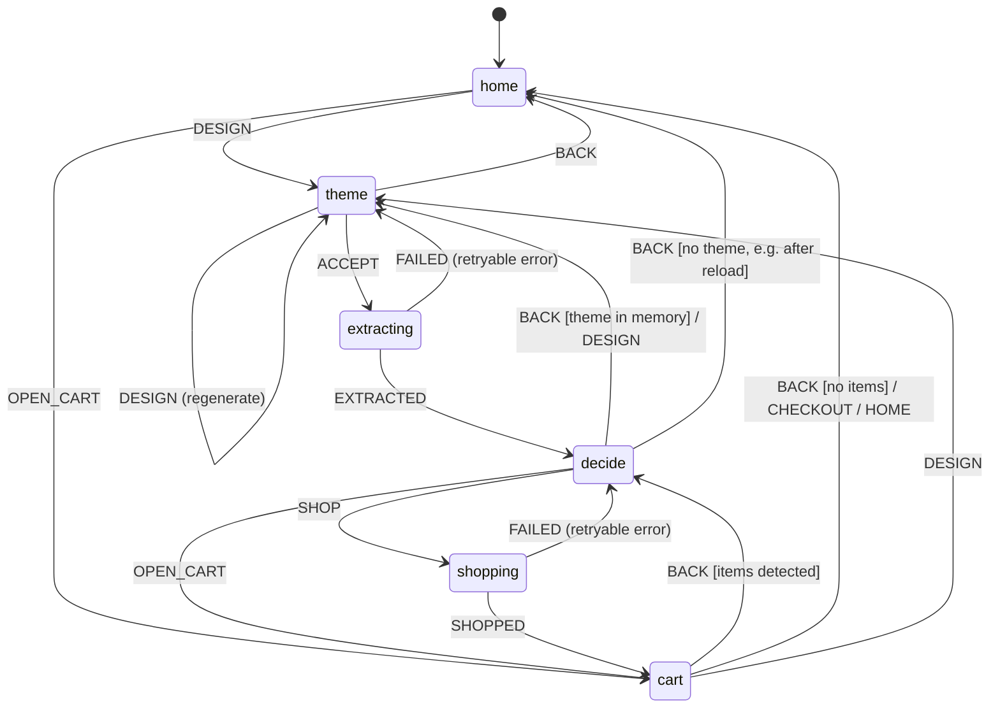

# State machines

All app flow lives in `public/machines.js` (pure, no DOM, unit-tested in
`test/machines.test.js`). `public/app.js` renders from these machines; it should
never decide "where we are" by checking which DOM nodes are hidden.

## Journey — one stage, exactly one surface

| Stage | Surface | Persisted? | Resumes to |
|---|---|---|---|
| home | `#landing-overlay` (+ bottom sheet) | yes | home |
| theme | `#theme-screen` | no (images in memory) | home |
| extracting | `#theme-screen` + scan overlay | no | home |
| decide | `#decide-screen` | `extractedItems` | decide |
| shopping | `#decide-screen` (CTA busy) | no | decide |
| cart | `#cart-screen` | `partyBucket` | cart |

The bottom sheet and the app title are Home-only (`body[data-stage]`); on
full-screen steps they used to cover the footer buttons and header.

## Other machines

- **Sheet**: position `collapsed | half | full` × mode `browse | checkout | results`.
  The checkout form is never destroyed; results render in `#checkout-results`.
- **Theme designer**: `idle → loading → ready | error`. Each request has a token
  (`designer.req`) and an `AbortController`; stale responses are dropped.
  Each facet is `loading → ready | failed` and a failed facet has its own retry.
  "Try a different look" sends `fresh: true` (skips the library cache) and is
  capped at 3 per theme preference.
- **Plan**: `planReadiness()` and `themeLabel()` are the only readiness/label
  logic. Changing party type or theme preference clears a designed theme.
- **Cart**: one line shape everywhere (`normalizeLine`). Legacy shapes are
  migrated on load; the checkout API shape is produced only at the boundary
  (`toCheckoutItems`).
- **Agent loop**: `idle ⇄ thinking`, one request in flight, at most
  `MAX_AGENT_TURNS` model calls per user message, messages appended through
  `pushMessage` so roles always alternate. The system prompt and every tool
  result include the current stage, cart and what the agent can do next.

## Debugging

- `window.partyplanner.snapshot()` gives stage, legal events, readiness, cart, designer and agent.
- `window.partyplanner.history` holds the last 50 journey transitions.
- Add `?debug` to the URL to log every transition.
- `GET /api/health` shows which upstream keys are configured.

## Tests

`npm test` runs these suites:
- unit tests for the machines
- server tests
- characterization e2e tests (pass on both the old and new code)
- regression e2e tests for each state bug

The e2e tests use headless Chrome with mocked AI endpoints. They need no API
keys and cost nothing to run.
